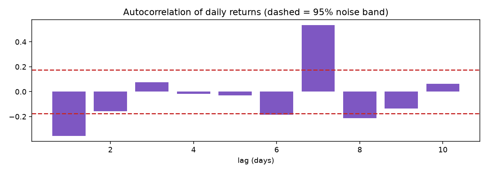
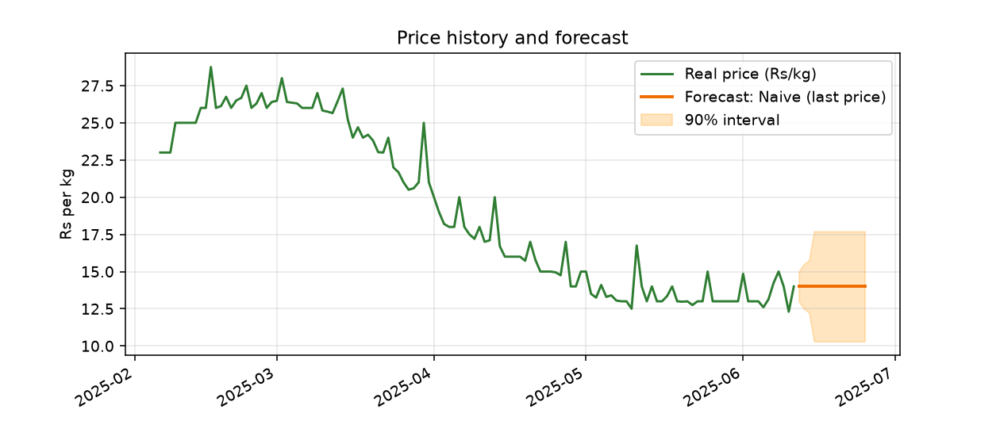
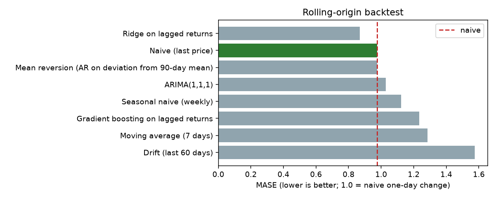

# Onion (All India): real-market analysis
*Generated 2026-10-22 from imported AGMARKNET data. Every figure below is produced by the project's analysis code.*

## 1. Data
- 126 daily observations, 2025-02-06 to 2025-06-11, from 1043 markets.
- Unit: INR per kg (AGMARKNET modal price per quintal / 100). Daily value = median across markets.
- Forward-filled days (gaps of up to 3 days): 0. Cut at a longer gap: True.
- Extreme one-day moves flagged (kept in the data): 0.
- Days since last observation: 498.

## 2. Is the price predictable at all?
**mean reversion.** Prices show statistically significant mean reversion over multi-day horizons (variance ratio 0.305, 0.229). That means structure exists that a model could in principle exploit; whether the models tried here actually did is what the backtest above reports.
- Ljung-Box (10 lags) p = 0.0
- Variance ratios: 5-day 0.305 (p=0.0051), 10-day 0.229 (p=0.0169), 20-day 0.258 (p=0.0986)

## 3. Forecast (14 days)
**Champion: Naive (last price).** No model was reliably better than assuming the price stays where it is. The best challenger (Ridge on lagged returns) was 11.0% better on MASE but not statistically significant (adjusted p=1.0), so the naive forecast is used.

| Day | Forecast (Rs/kg) | 90% interval |
|---|---|---|
| 2025-06-12 | 14.0 | 13.0 - 15.0 |
| 2025-06-14 | 14.0 | 12.25 - 15.75 |
| 2025-06-16 | 14.0 | 10.3 - 17.7 |
| 2025-06-18 | 14.0 | 10.3 - 17.7 |
| 2025-06-20 | 14.0 | 10.3 - 17.7 |
| 2025-06-22 | 14.0 | 10.3 - 17.7 |
| 2025-06-24 | 14.0 | 10.3 - 17.7 |

Interval check: calibrated on the older half of the test points, the 90% interval covered the real price None of the time on the newer half (0 test points).

## 4. Model comparison (rolling-origin backtest)
Rolling-origin cross-validation (expanding window, refit at every origin); 7 forecast origins over the last 56 days.

| Model | MASE | MAE (Rs/kg) | sMAPE % | Wins vs naive | p (Holm-corrected) |
|---|---|---|---|---|---|
| Ridge on lagged returns | 0.868 | 0.7387 | 5.45 | 0.714 | 1.0 |
| Naive (last price) | 0.975 | 0.8294 | 5.82 | - | - |
| Mean reversion (AR on deviation from 90-day mean) | 0.975 | 0.8294 | 5.82 | 0.0 | - |
| ARIMA(1,1,1) | 1.028 | 0.875 | 6.12 | 0.714 | 1.0 |
| Seasonal naive (weekly) | 1.124 | 0.9559 | 6.44 | 0.429 | 1.0 |
| Gradient boosting on lagged returns | 1.233 | 1.0488 | 7.91 | 0.286 | 1.0 |
| Moving average (7 days) | 1.285 | 1.0928 | 7.51 | 0.714 | 1.0 |
| Drift (last 60 days) | 1.576 | 1.3406 | 10.38 | 0.286 | 1.0 |

A model counts as better only if it beats naive on MASE and the Diebold-Mariano test is significant after Holm correction for testing several models.

## 5. Would following the forecast have paid?
The model never forecast a rise large enough to justify waiting, so the policy is identical to selling immediately.
- Per decision over 7 past test points (wait only if a rise of 3.0%+ was forecast): following the forecast 0.0% (95% interval 0.0% to 0.0%); always waiting -3.68%; selling now 0%.
- Storage cost, spoilage and interest are not deducted, so real gains would be lower. The champion model was chosen on these same test points, so this is somewhat optimistic. Test points overlap in time; the interval uses a block bootstrap to allow for that.

## 6. Seasonality, volatility and markets
- Seasonality: Less than one year of history - no seasonal pattern can be measured.

- Volatility: normal (39.68% over 30 days; 39.6th percentile of its own history).
- Market spread over the last 30 days: 492.1% across 686 markets; highest North Paravur (Rs 65.0/kg), lowest Rajgarh (Rs 3.0/kg).

## 7. Limitations
- Real AGMARKNET wholesale (mandi) prices, not the marketplace's own listings.
- Intervals are conformal: they reflect how wrong this model type has actually been on this series, not a guarantee.
- Forecasts cannot anticipate shocks (weather, policy, export bans).
- Weather, policy changes and export restrictions are not modelled.
- Wholesale mandi prices are not the price a farmer receives at the farm gate.
